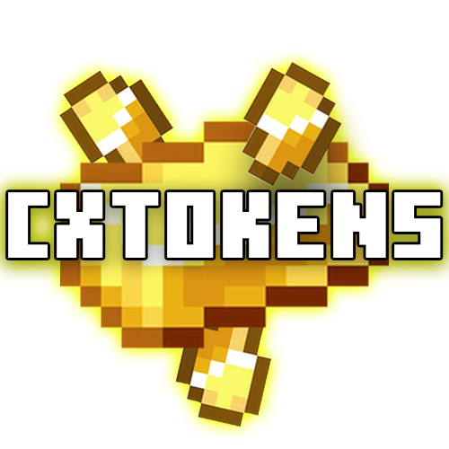
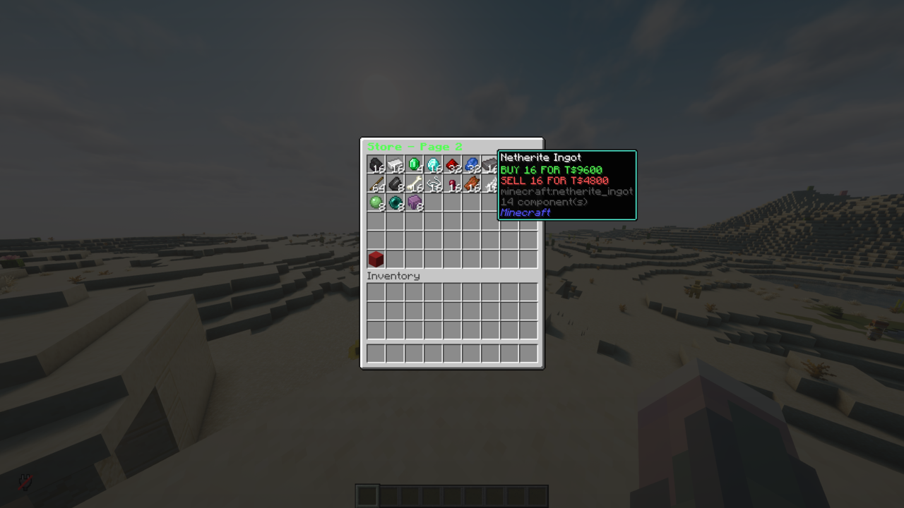
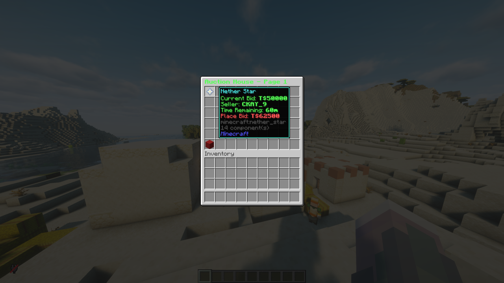
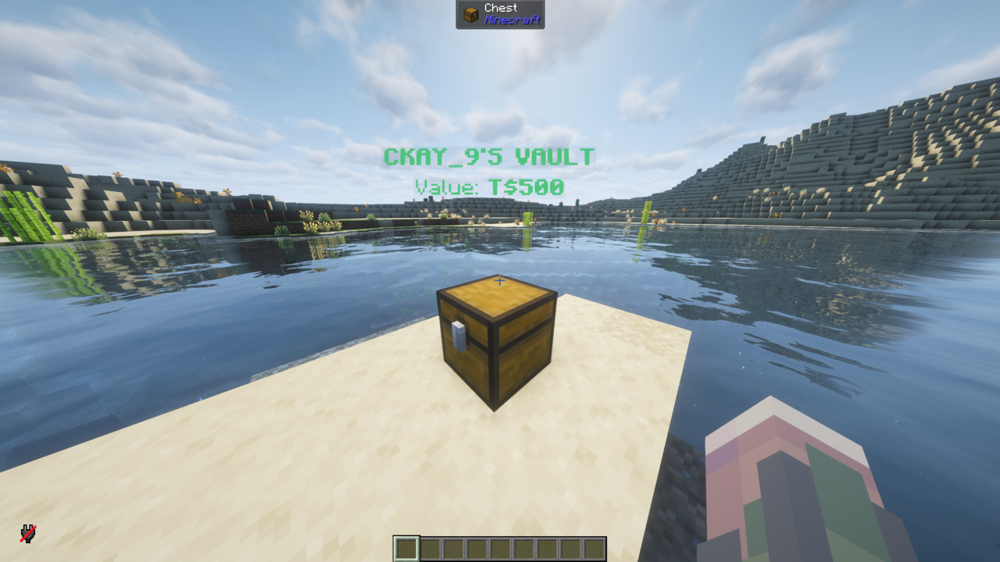
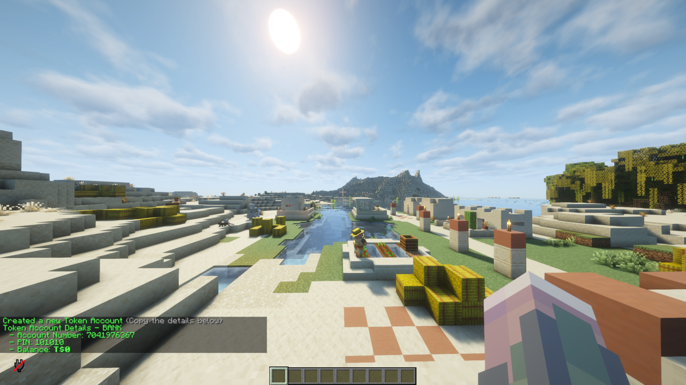

    

CxTokens is a complete, highly configurable economy plugin for Spigot and Paper servers. Players earn and spend tokens through a static item store, a live auction house, bounties, lotteries, vaults, and shared token accounts.

## Installation
1. Download the latest release of CxTokens.
2. Place the .jar file in your server's `/plugins` folder.
3. Restart or reload your server.
4. Edit the config and store files in `/plugins/CxTokens`.
5. Restart or reload your server to apply your changes.

## Features
CxTokens bundles everything a server economy needs into one plugin, so players always have something to earn, trade, and compete for.

### Lottery
At a configurable interval, a new lottery opens and players can join for a set fee. When the join period ends, a winner is chosen at random and receives the entire prize pool.

### Item Store
The Item Store (also called the static store) is a fixed, fully configurable shop where players buy and sell items through a simple menu.

### Auction House
The Auction House lets players sell unique items outside the Item Store. Each new bid must exceed the previous one by a set percentage. When the timer runs out, the top bidder receives the item. If nobody bid, it returns to the seller.

### Bounties
Place a bounty on another player. Whoever fulfills it (for example, by killing the target) collects the reward.

### Vaults
Vaults let players store tokens in a physical location in the world. They pair well with pay-on-death, where players lose a portion of their tokens to their killer.

### Token Accounts
Token Accounts provide a shared balance. Anyone with the correct account number and PIN can access it, which makes them ideal for teams, towns, and shared projects.

### Highly Configurable
Nearly every component, event, and function can be disabled, changed, or tuned in the config files. The default store prices are only placeholders, so adjusting them to suit your server is recommended.

## Commands
- `/cxtokens`, `/tabout`: Information about CxTokens
- `/tadmin`: Admin tools (e.g. add or subtract tokens)
- `/tbounty`: Place a bounty on a player
- `/tbal`: View your balance or another player's
- `/tstore`: Open the Item Store
- `/tauction`: Open the Auction House
- `/ttop`: See who has the most tokens
- `/tsend`: Send tokens to a player
- `/tsell`: Sell the contents of a container (e.g. a chest) all at once
- `/treset`: Reset your token profile
- `/tlottery`: Join the current lottery, if one is running
- `/tvault`: Create vaults
- `/taccount`: Create, access, and manage Token Accounts
